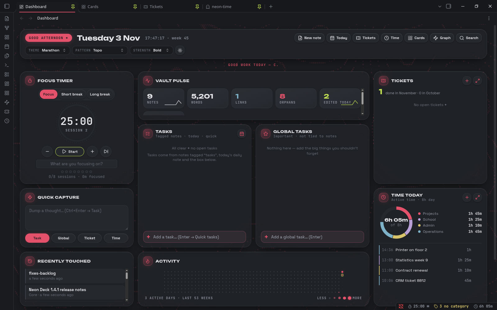
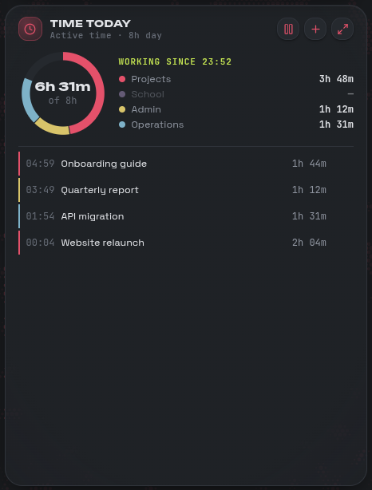
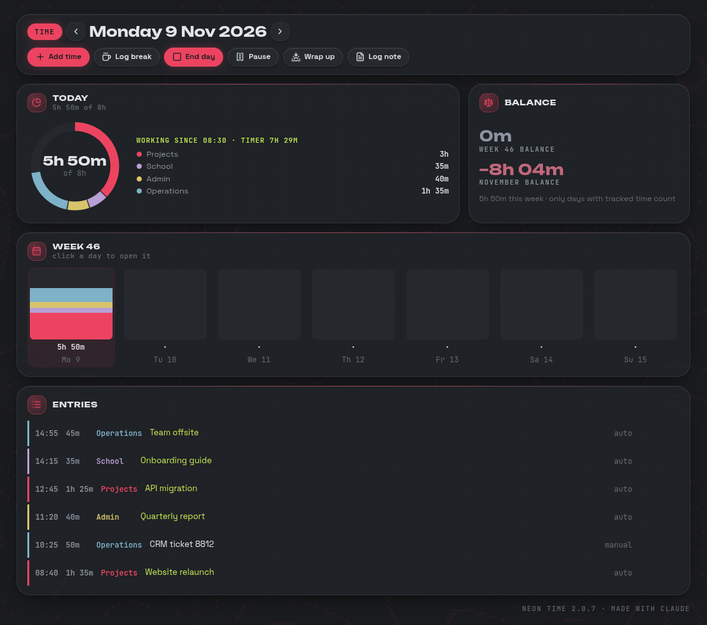

# ✦ Neon Deck

Five small Obsidian plugins that work together as a personal command centre: a dashboard, tasks, tickets and automatic time tracking, in a neon look with live background patterns.

Everything runs **100% locally**: no network calls, no telemetry, no remote fonts or code, no `eval`. Files are only written when you do something that writes.

| Plugin | What it does |
|---|---|
| **Neon Deck** | Dashboard, themes, live patterns, quick capture, card explorer, note graph, weekly review |
| **Neon Tasks** | Tasks widget, Global tasks, the New note card, Fix properties |
| **Neon Tickets** | Ticket view and pop-up, New ticket form, tracker, reminders, self-writing log, monthly counter |
| **Neon Time** | Active time per category, manual entries, overtime, daily Time Log notes for an AI agent |
| **Neon Write** | Table picker, slash menu, a toolbar on selected text and a faint pattern behind notes |

Neon Deck is the core. The others plug their cards, capture targets and facts into its dashboard. Turn any of them off and the rest keeps working; the dashboard gives the free space to the neighbours.

## Features

### Dashboard (Neon Deck)
- Totals, Vault pulse, Quick capture, Recently touched, Activity board, Tasks, Global tasks, Tickets and Time today on one page.
- **One main pane.** A nav list at the top of the left sidebar (Dashboard, Cards, Tickets, Time, Graph) switches what the main pane shows. Notes open in that same pane, and Back / Forward move between them. No pile of pinned tabs.
- The grid fills the window on any screen size; lists scroll inside their card, and narrow panes stack the cards.
- Themes (Marathon, Cyberpunk, Brutal, Calm, Paper, Night shift, Phosphor, Blueprint), each in light and dark.
- A live background pattern (Damascus, Meteorite, Topo, Circuit, Hex mesh, Datastream, Radar) that pauses when Obsidian isn't focused or with *Reduce motion* on.
- A ticker with live facts, and a Totals card: time worked, days worked, tasks and tickets done, notes created.
- Quick capture from anywhere with `Ctrl+Shift+Space`: send to Task, Global task, Ticket or Time entry.
- Card explorer with category chips and a *Revisit* reminder for notes you haven't opened in a while, plus a local note graph that follows the theme.

### Tasks (Neon Tasks)
- Open tasks from notes tagged `tasks`, today's daily note and a Quick tasks note, grouped Overdue · Today · Later.
- Global tasks for the big things that aren't tied to a note, with a daily read-only backup.
- A New note card that asks for name, kind and category, and *Fix properties* to tidy frontmatter.

### Tickets (Neon Tickets)
- A ticket is a normal note with `type: ticket`. It opens as a pop-up with steps, a log that writes itself, due dates, reminders and a Waiting state with follow-ups.
- Done tickets file themselves into `Done/YYYY-MM/`; a counter reads like *14 done in November · 11 in October*.
- **Templates:** a Templates tab in the tracker to add, edit, duplicate and delete ticket blueprints (steps, description, priority, due). Pick one in New ticket and its steps are filled in. Stored locally in the plugin's data.

### Time (Neon Time)

- Counts active time only while a note is the focused tab and you type, scroll or click. It stops after a configurable idle time.
- Category comes from checkbox properties (`projects`, `school`, `admin`, `operations`) or tags. `untracked: true` notes are never logged.
- A donut against your workday target, overtime as an accent slice, weekly and monthly balance, and entries you can add, edit or delete (with Undo).
- **Wrap up** at the end of the day, and one Time Log note per day (`Core/Time Log/YYYY-MM-DD.md`) with totals, a Done today list and an entries table, written for an AI agent to send on to Jira. Neon Time itself never connects to Jira or the network.

 

### Writing (Neon Write)
- **Table picker:** hover a rows × columns grid (or use the arrows) and click; an empty table lands at the cursor with the cursor in the first cell. Open it from the slash menu, the right-click menu or `Ctrl+P → Neon Write: Insert table…`.
- **Slash menu:** type `/` at the start of a line or after a space for tables, headings, lists, checklists, quotes, callouts, code blocks, dividers, note links and today's date. Keep typing to filter.
- **Toolbar on selected text:** bold, italic, strikethrough, highlight, inline code, note link, heading (H1 → H2 → H3 → none) and callout. Press a button again to undo it.
- **Lifted writing window:** the note sits on a rounded, raised card that grows with the pane (70% of it, 700–1020px of text).
- **Theme fonts and colours in notes:** body text, headings and code use the Neon theme's fonts; titles alternate between its primary and secondary colours.
- **Images to Core/Images:** new `.png` / `.jpg` files move there automatically and links keep working; a command moves existing ones.
- **Pattern behind notes:** the dashboard's pattern, dimmed right down, behind the note you're writing (needs Neon Deck; strength and on/off in settings).
- Optional: turn Neon Write off and the other four behave exactly as before.

## Install

These plugins aren't in the Community plugins list. Install them by hand:

1. Close Obsidian, or be ready to reload it.
2. Copy the `neon-deck`, `neon-tasks`, `neon-tickets`, `neon-time` and (optionally) `neon-write` folders into your vault's `.obsidian/plugins/` folder.
3. In Obsidian, open **Settings → Community plugins**, turn off Restricted mode if needed, and enable the plugins. Enable **Neon Deck** first, since the others add to its dashboard.
4. Open the dashboard from the ribbon `▦` icon or `Ctrl+P → Neon Deck: Open dashboard`.

Requires Obsidian 1.5.0 or later.

## For developers

- **No build step.** Each plugin's `main.js` is the source; edit it and reload Obsidian (`Ctrl+R`).
- **Shared helpers.** Lines 1–423 of every `main.js` are the same shared helper block (DOM helpers, modals, categories, daily notes, cross-plugin glue). Keep the five copies identical; `ND_VERSION` lives there too.
- **Plugins talk through Neon Deck's API** (`registerWidget`, `registerCapture`, `registerFacts`, …) and workspace events such as `neon:time-entry` and `neon:task-done`.
- **Saved data** (`data.json` in each plugin folder) is personal and isn't in this repo.
- To release a new version, bump `ND_VERSION`, the header comment and `manifest.json` in all five plugins.

## Release notes

Only the latest release notes are kept: [1.6.2](docs/release-notes/1.6.2.md): ticket templates (Templates tab, editor, picker in New ticket), instant step adding, the log keeps only finished steps. Older notes are in the git history.

## License

**Free to use and fork, never to sell.** From 1.6.0 on, Neon Deck is licensed under [CC BY-NC-SA 4.0](https://creativecommons.org/licenses/by-nc-sa/4.0/): you may use, share and fork it with credit, but not sell it or use it commercially, and forks must keep the same license so they stay free too. See [LICENSE](LICENSE). (Versions up to 1.5.0 were MIT.) The bundled fonts keep their own license (see below).

## Credits

Made by [Yobzs](https://github.com/Yobzs) with Claude.

Bundled fonts (in `neon-deck/fonts/`): JetBrains Mono, Space Grotesk and Unbounded, all under the SIL Open Font License 1.1. See [`neon-deck/fonts/OFL.txt`](neon-deck/fonts/OFL.txt).
