# ✦ Neon Work

A command centre for an Obsidian vault: a dashboard, projects, tasks, time tracking, research notes and a few writing touches, in a neon look with live background patterns, now with project planning: Gantt charts, a kanban board and reports.
By Kevin Mulholland, built on [Neon Deck](https://github.com/Yobzs/neon-deck-obsidian) by Yobzs.

> [!NOTE]
> **1.5.4:** links from your notes to the plugin's tabs (`obsidian://neon-work?open=projects`), and page previews when hovering a note in its lists. See [the release notes](docs/release-notes/1.5.4.md).
>
> **1.5.3:** a tidy-up after Obsidian's automated review (styles without `!important` or `:has()`); needs Obsidian 1.7.2 or later. See [the release notes](docs/release-notes/1.5.3.md).
>
> **1.5.2:** a new note opens in its own tab with the cursor in it, and tabs keep their names after a restart. See [the release notes](docs/release-notes/1.5.2.md).
>
> **1.5.0:** Planning knows about **holidays and time off** (UK public holidays built in, closures, any country's dates, people's leave, per customer or Area), has its **own calendar** in the task editor, and makes a **report for other people**: a summary, then the project note itself. Also editing on the Gantt chart, steps under a task, tasks that run alongside, and cancelling or deleting tasks. See [the release notes](docs/release-notes/1.5.0.md).
>
> **Planning** arrived in 1.4.0: a lightweight project planner over the tasks in your project notes ([1.4.0 release notes](docs/release-notes/1.4.0.md)).

Neon Work sits on top of a vault you already have:

- **Read-only by default.** It reads your notes and changes nothing until you switch read-only off, and even then only when you act (tick a task, set a status, create a note).
- **It never moves your files**, and creates nothing until a feature needs it.
- **It reads your own conventions**: notes tagged `project`, `#task` lines, a `status` property, customer folders (`1.Customers/<customer>/…`), your templates and your daily (or weekly) note settings.

Everything runs **100% locally**: no network calls, no telemetry, no remote fonts or code, no `eval`. [FORK.md](FORK.md) lists everything that differs from the original plugin; [docs/architecture.md](docs/architecture.md) describes how it is built.

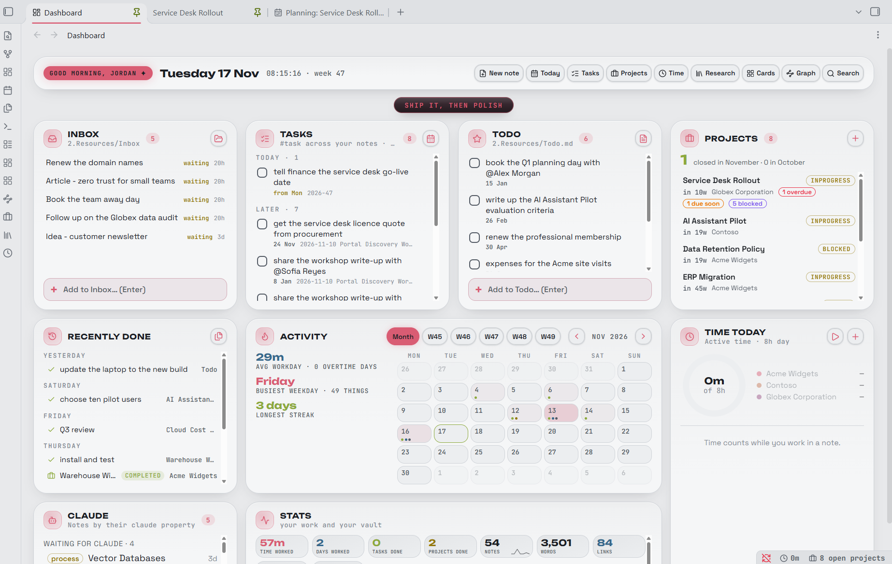

## What it does

The plugin has six parts (Planning is part of Projects). Each can be switched off in the settings, and the others keep working. A list at the top of the left sidebar (Dashboard, Cards, Inbox, Tasks, Projects, Time, Research, Graph) switches what the main pane shows; notes open in the same pane, and Back / Forward move between them. The **?** button at the top of each tab opens this guide inside Obsidian, at the part you are in, with links to the pictures here.

### Dashboard

- **Cards** on one page: Totals, Vault pulse, Recently done, Activity (a month calendar, and this week with two weeks either side), Tasks, Todo, Projects, Time today and the **Claude card** (notes whose `claude` property asks for Claude's work, and notes Claude changed for you to review).
- **Recently done:** the last 14 days of finished work, read from your notes: tasks ticked with a ✅ date (in the editor, the Tasks plugin or these cards) and projects with a `completed` or `cancelled` date. Works in read-only mode.
- **Ticker and pin board:** a live line of facts at the top that opens into a pin board. Drop a note, a file or some text on it to pin it; pins live in one note, one line each.
- **Quick capture:** type a thought and send it to an **Inbox note** (a new note in your inbox folder, from your inbox template), the **Todo** note, a new **Project**, a **Time entry** or the pin board. Enter sends; Shift+Enter starts a new line (on the pin board, each line becomes a pin).
- **Card explorer** (sidebar or tab): your folders and notes as cards, coloured by customer, with filter chips per customer.
- **Note graph** (desktop): your notes as clusters of linked topics. Its **Gaps** list shows topics that ought to connect but barely do ("What connects [[A]] with [[B]]?"); **Bridge note** makes a note in the *Bridges* folder with that question and links to both sides, to help you think it through. Its **Structure** scale rates how your notes cluster, from *Biased* (one topic dominates) through *Focused* and *Diversified* to *Dispersed* (many loosely linked islands), from how cleanly they split into topics (modularity) and the share of the largest topic; hover over a level for its meaning.
- **Weekly review** (*Create / open this week's review*): a note from your review template with the week in numbers and the notes you created or edited.
- **Themes and patterns:** nine themes, each in light and dark, with a live pattern behind the dashboard; chosen in *Settings → Dashboard*.

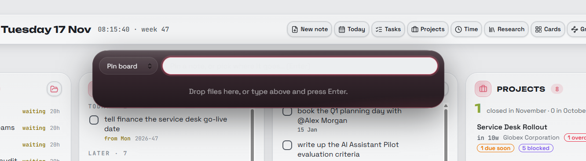

### Tasks

- **Tasks tab and card:** every open `#task` line across the vault (`[ ]` and `[/]`), grouped Overdue · Today · Later by 📅 due or ⏳ scheduled date. Tasks in project notes belong to their project's plan and stay off this list (setting *Tasks in projects*). Tick, edit or open each one in place; the date and note sit on a small line under the task text. Notes tagged `tasks` and recent daily or weekly notes count every checkbox.
- **Todo card:** the open tasks of your Todo note in file order. New tasks go at the head of that note as `- [ ] #task … ➕ date`; ticking writes `[x] … ✅ date`, as the Tasks plugin does.
- **Timeline:** a card on the Tasks tab draws dated tasks as a Gantt chart, one section per note: a bar from 🛫 start to 📅 due, otherwise a diamond on the due date; overdue red, due within a week orange, in progress cyan, the rest blue. A click opens the task. Zoom (3 months, 12 months, all). Can be switched off in settings.
- **New note:** pick a customer and a kind (note, meeting, person, project, research); the note goes in `<customer>/<Meetings | People | Research>/` from that kind's template. People notes are named `@Name` with an `aliases` property.

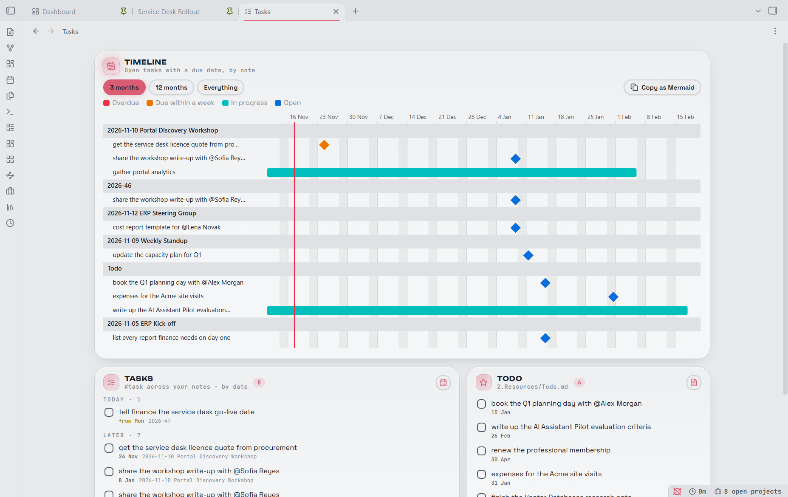

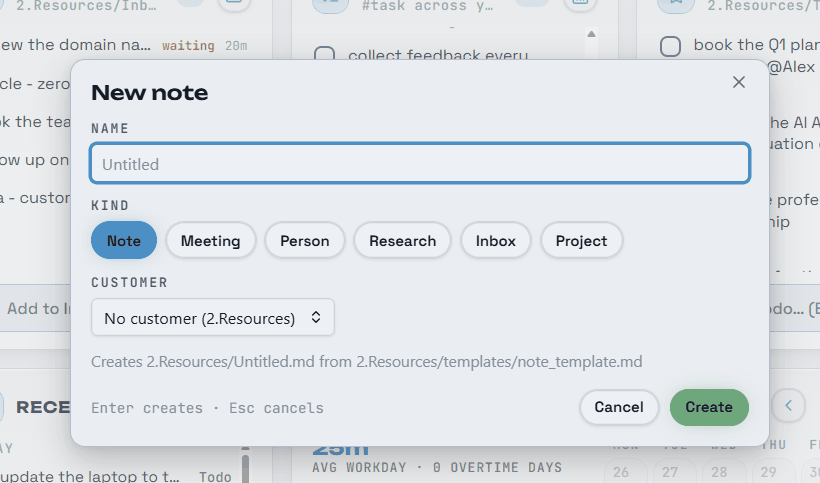

### Projects

- **Projects tab and card:** notes with `project` in their tags, grouped by customer (or status, due date and more). The customer is the `customer` property, else the customer folder the note is in.
- **Your status values** in four groups: not started (`init`), active (`inprogress`, `ongoing`), on hold (`paused`, `blocked`) and closed (`completed`, `cancelled`). Changing a status only updates properties: `status`, plus today's date in `completed` (or `cancelled`).
- Each row shows the status, customer, `stage`, start date, `note`, a due-date bar and, for projects with a plan, how its tasks stand and the forecast finish. Postpone, set the due date or a reminder, or edit the note property from the row's menu.
- **Timeline: all projects in one view** above the list on the Projects tab (the *Timeline* button or a setting hides it), one section per customer: a bar from `started` to the plan's forecast finish (else `due`, or `completed` once closed), a diamond on the due date, coloured late, needs attention, in progress, not started, on hold or closed, and a line for today. A click opens the project's Planning view. Zoom (3 months, 12 months, all).
- **New project:** a name and a customer; the note goes in `<customer>/Projects/` from your project template.
- **Reminders** appear inside Obsidian, once a day per project, when a project is overdue, due soon or past its remind date.

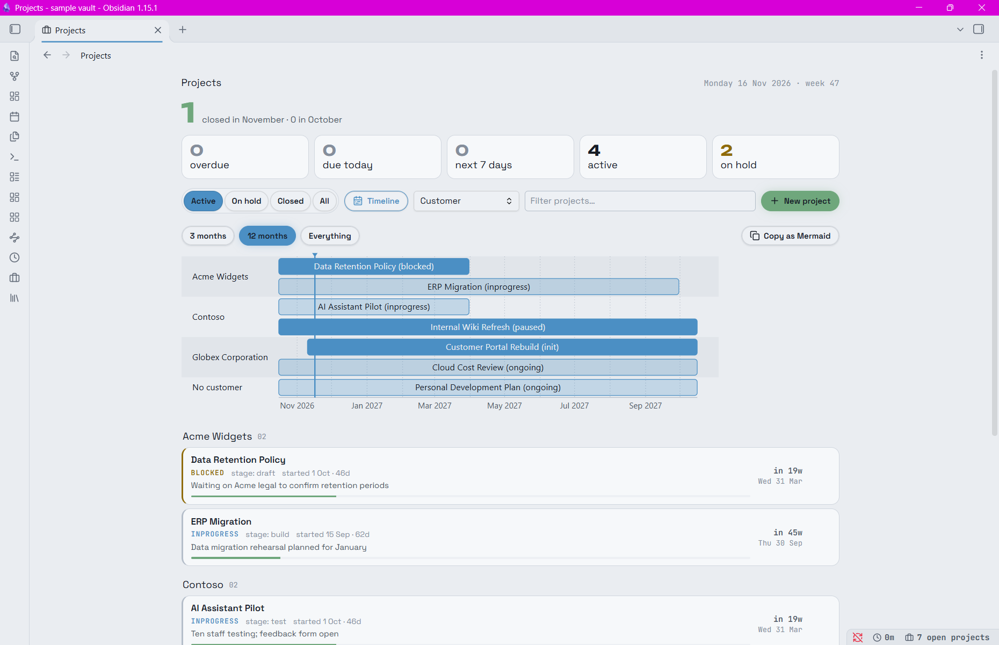

### Links to the plugin's tabs

A note can open any of the plugin's tabs with a link: `[Projects](obsidian://neon-work?open=projects)`. `open` can be `dashboard`, `projects`, `tasks`, `research`, `time`, `inbox`, `cards`, `graph`, or `planning` with `&project=` and the project note's name or path (and `&mode=board`, `graph` or `list`). The command *Copy a link to this tab* copies a ready-made link for the tab in front. Hovering a note's name in the Projects, Research, Tasks and Inbox lists shows Obsidian's page preview (with Ctrl / Cmd, or without: *Settings → Page preview*).

### Planning

A lightweight planner over the tasks already in a project note (or a project folder). Open it with the **Planning** button in the note's header, the project's menu, or *Project: open Planning*.

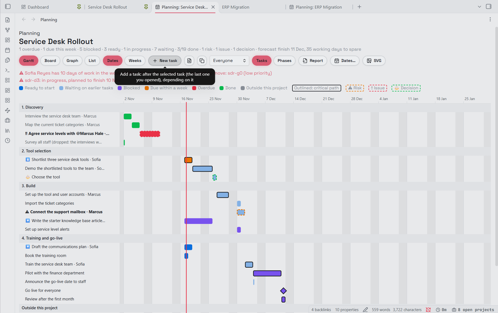

- **In the task line**, next to what the Tasks plugin uses: an id `🆔 sdr-4`, what it waits for `⛔ sdr-2,sdr-3`, tasks it runs alongside `[starts-with:: sdr-2]` (starts no earlier than that one starts) and `[ends-with:: sdr-3+2d]` (finishes no earlier than that one finishes, here two working days after), an estimate in working days `[duration:: 3d]` (or `1w`), owners `[owner:: [[@Sam Taylor]]]`, and the tags `#milestone`, `#blocked`, `#risk`, `#issue`, `#decision`. The phase is the heading the task sits under.
- **Gantt, Board, Graph and List** in one tab, in the same colours: ready, waiting (earlier tasks open but on time), blocked (something upstream is overdue or `#blocked`), in progress, due soon, overdue, done. The critical path is outlined; risks and issues are bold with a dashed outline.
- **Editing on the Gantt** (desktop and tablet): arrows show what waits for what (faint, strong on the critical path or when the task waited for is late; hover a task to pick out its own). Drag a bar's right end to change its length, drag the bar to start it later (writes 🛫, "not before": what waits for it moves too; it can't go before what it waits for), and **Alt**-drag from one bar onto another to link them by the ends you use: right end to its left end, it waits; left end to left end, it starts with it; right end to right end, it ends with it (dashed arrows). Click an arrow to remove that link. **Undo** puts the last change back.
- **Priority** (the Tasks plugin's 🔺 ⏫ 🔼 🔽 ⏬) shows on cards, Gantt rows and in the List, highest first on the board; it doesn't change the schedule.
- **Board:** drag a card to change its checkbox; rows by phase or by person. **List:** − / + to change a duration, slip against the baseline (saved automatically when the project starts, provisional — following the plan — until every open task has a duration, then locked; lock it early or re-baseline from the tab's ⋯ menu), a filter for risks, issues and decisions.
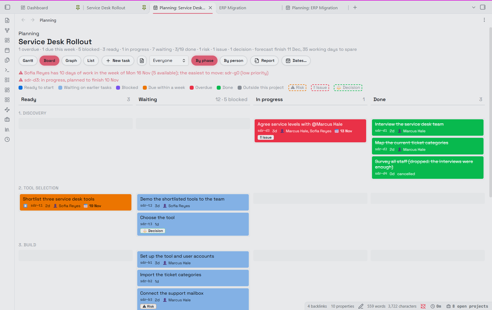

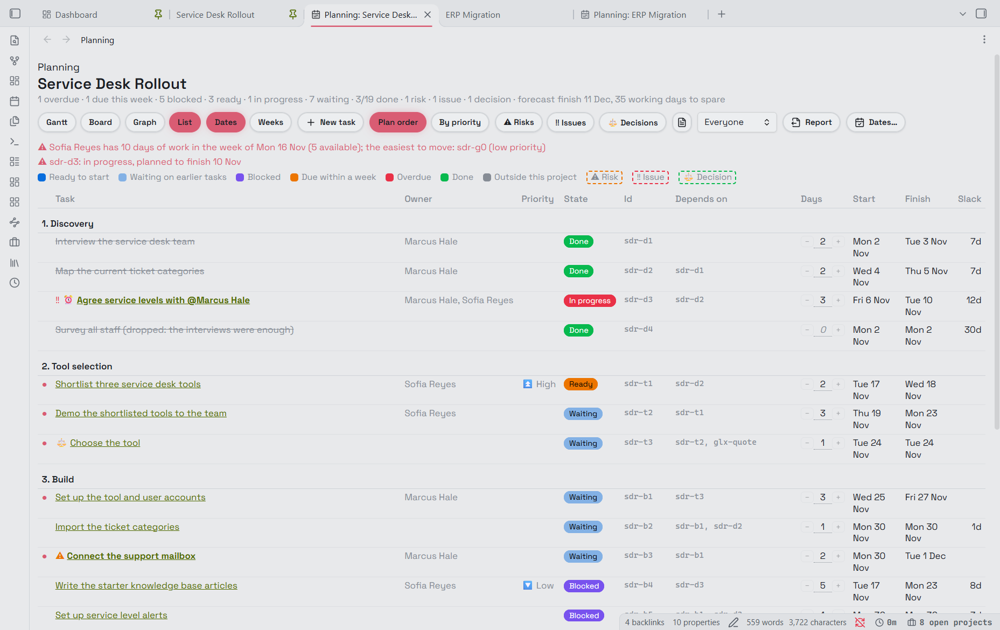

- **Task editor:** click any task (or right-click in the note: *Planning: edit this task*; also a command, so it can have a hotkey). Description, status, priority, phase, owners, duration or milestone, markers, depends on / blocks (loops can't be made), dates (type them, or pick from the plugin's calendar with the button beside each: weekends, holidays and closures greyed, your own time off striped on your tasks (set **You** in *Settings → Projects*) and anyone else's underlined in orange, named on tap, the plan's own start and finish outlined, the reason shown on hover or tap; any day can still be picked; on phones and tablets the field opens this calendar too), and an id given automatically; a preview shows exactly what will be written. **New task** follows the selected task. **Cancel task** marks it ❌ (it stays in the note); **Delete task…** removes it and its steps, takes its id out of the tasks that depend on it, and asks first, listing all of that.
- **Report** saves a printable note of the plan (a summary first: forecast, the Gantt chart, phases, people, what needs attention, risks, workload; then the project note itself up to its last task, without the plan's ids and links, so research kept below the plan is left out) in the reports folder; print it with *Export to PDF*. **Write dates…** records today's planned dates in the tasks you tick (🛫 start, 📅 due): a snapshot that then holds the plan. To have the current plan show in the Tasks plugin and calendars instead, turn on **Keep ⏳ scheduled dates in step with the plan** in the tab's ⋯ menu (per project, stored as `plan-scheduled: true` in the project note): Planning then updates each open task's ⏳ whenever the plan moves it, and never touches 🛫 or 📅. **Forecast finish** against the project's `due` date, a **baseline** to see slip, a person filter with a warning when someone has more than five days of work in a week, and weekend dates flagged.
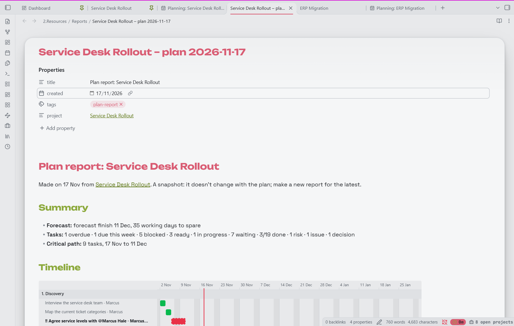

- **Steps:** the checkboxes directly under a task (`- [ ]` / `- [x]`, or `- ( )` / `- (x)`) are its steps, shown as 2/4 on its bar (with a progress line), in the List and on its card; cancelled ones (`[-]`, `(-)`) and notes such as `[?]` don't count. When every step is done but the task isn't, Planning offers to tick it (it never does so by itself). A task tagged `#task` (or with a 🆔) inside another task is flagged: make it a plain checkbox or its own task.
- **Holidays and time off:** Planning reads working days, holidays and time off from a **Holidays** note (the name is a setting in *Settings → Projects*). It looks in the project's folder, then each folder above it, then the project's customer or Area folder (also when a property names it, as in a PARA vault: `area: [[Work]]`), then the base folder, so a customer or Area can have its own (say, another country, or Work but not Home) and the base folder holds the shared one:

  ```
  ## All
  - public holidays: England and Wales
  - working days: Mon-Fri
  - 2026-12-29 to 2026-12-31 Office closed

  ## People
  - [[@Kevin Mulholland]]
      - 2026-12-24 to 2027-01-02
      - every Tuesday
  ```

  **All** is for everyone: public holidays built in for England and Wales, Scotland or Northern Ireland (worked out each year, substitute days included), the working week, and any dated day off with its name: closures, one-off bank holidays, or another country's public holidays, which you add each year (Planning warns when a plan runs past the last year listed). The calendar comes from the nearest Holidays note with an All section; people's time off is gathered from all of them and from a project note's own `## Holidays` section. Write a person as in `[owner:: …]` (or just their first name). Planning skips days off in every date it works out and shades them on the Gantt; a task takes longer when its owner is off (with several owners, a day counts when all of them work); the workload warning counts each person's own days available that week; the report lists the plan's holidays and each person's time off. Dates are always YYYY-MM-DD. Weeks view has no dates, so it keeps plain Monday to Friday.
- **Plan problems:** a ⛔ id no task has (say, after folding tasks into a holding task), an id used twice or a dependency loop is listed at the top of the Planning view, naming the task (click to open the note at that line), in the report's *Needs attention*, as a pill on the project's card and row, and underlined in the note itself while you edit it (hover for the reason; nothing is written).
- **Plan template:** `project_plan.md` (in the sample vault's templates) gives four phases of example tasks with ids filled in by New project.

Planning writes only when you act (a drag, a save, a menu choice), only the task lines involved, and never with read-only on. The Tasks plugin's `is blocked` means what Planning calls *waiting*.

### Research

- **Research tab:** each section is a folder shown as a topic tree. A pattern such as `1.Customers/*/Research` gathers every customer's research folder into one section, labelled by customer.
- **By status:** the section's notes grouped by their `status` property, with "N to research · N researched" in the header.
- **Link suggestions:** the status bar offers to link words that match the titles of other research notes.
- New research notes start from your research template.

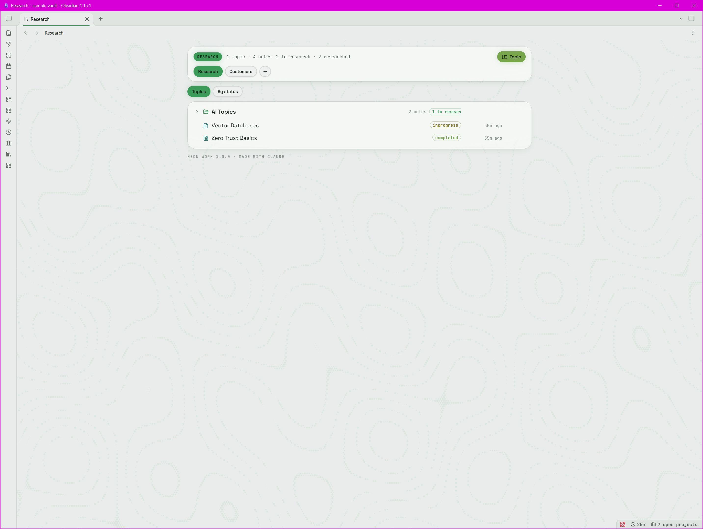

### Time

- **Automatic time** per customer while you work in a note, plus manual entries, breaks, a workday timer and overtime.
- **Time tab** and a **Time today** card; *Wrap up the day* at the end.
- An optional **daily time log note** with totals per customer and a table of entries, for you or an AI agent to read. Nothing is sent anywhere.

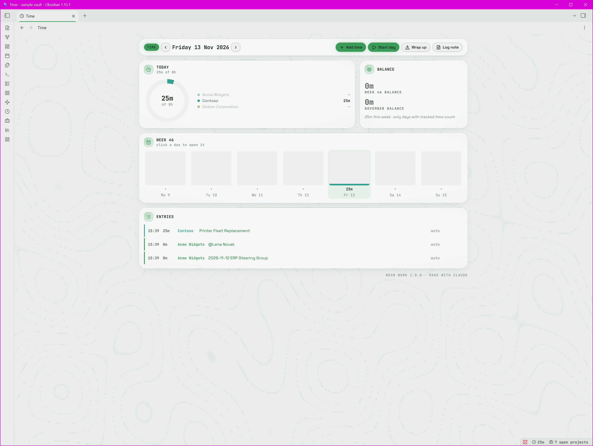

### Write

- **Table picker** (`Insert table…`), merged table cells, styled tables, lime dividers, sub-titles and page breaks for PDF export.
- **Locked callouts and maths blocks:** lock one so it can't be edited by accident.
- **Lifted writing window:** the note sits on a raised card over the dashboard pattern (full width when Obsidian's *Readable line length* is off).

## Other vault layouts

Neon Work started with a vault organised by customer, but the customer is just a group: rename it (Area, Client, Team…), choose the property it's read from and the folder whose subfolders are the groups, in *Settings → Neon Work → Projects*. For a PARA vault, for example: group name `Area`, group properties `area, parent` (names or links such as `[[Photography]]`), groups folder `2.Areas`, project tag `projects`, project folders `1.Projects` (each folder there is a project too), New note types for area notes and resources, and the **Areas card** on the dashboard (projects, tasks and recent notes per area, quietest first). Several task tags (`#task, #todo`) and ignored tags (e.g. `vault_index` folder index notes) help with vaults that have many checklists or generated notes.

## On phones and tablets

Dashboard, Tasks, Projects and Research also run on mobile: one column on a phone held upright, two on a phone turned sideways or a tablet, and long press for the menus that right-click opens on the desktop. Time tracking, Write, the card explorer and the note graph are desktop-only. To preview the mobile layouts on the desktop, run `app.emulateMobile(true)` in the developer console.

## Settings

Everything is on one page, *Settings → Neon Work*, with a section per part:

- **Overview:** read-only, the base folder, the switches for each part, and safe mode.
- **Dashboard, Tasks, Projects, Research, Time, Write:** that part's options. Folder and file fields suggest matching vault paths as you type.

The **base folder** (asked on first start) is where the plugin keeps what it makes for itself when a location is left empty: Projects without a customer, Reviews, Time Log, `Todo.md`, the pin board and graph bridges.

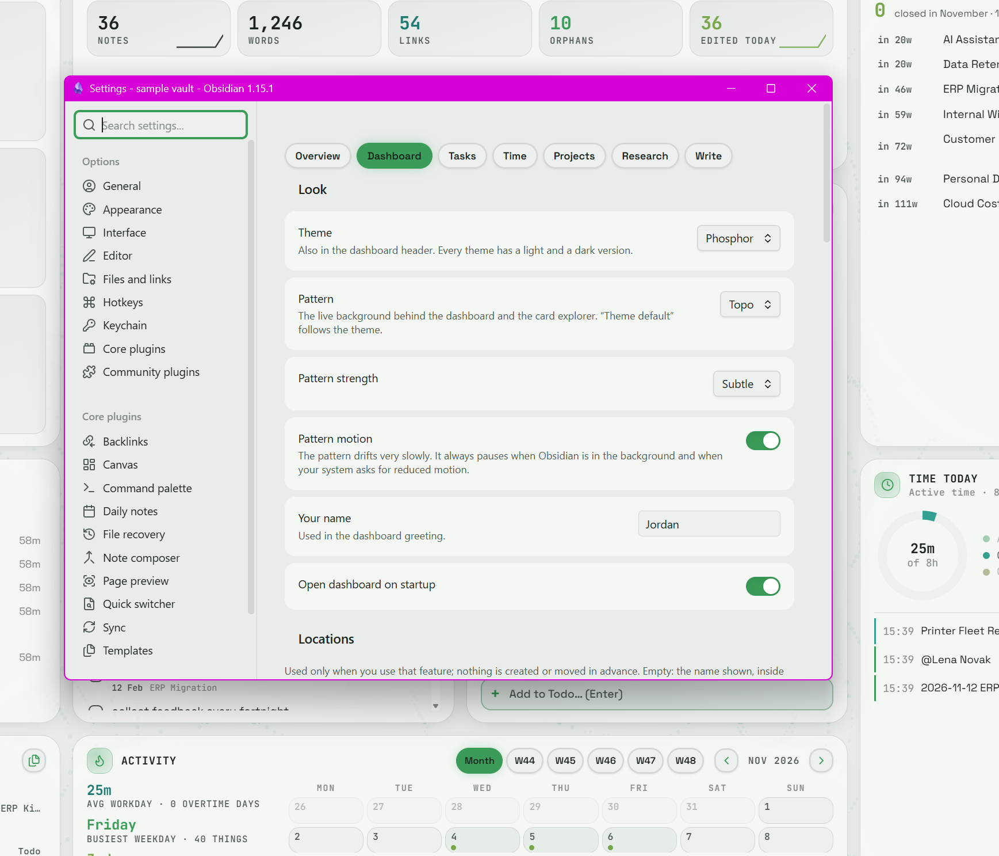

## Try it first

The repo includes a **sample vault** (`sample vault/`) with made-up customers, projects, meetings, people, research and tasks (open *Service Desk Rollout* and press **Planning** to try the planner), and the plugin already installed and set up (read-only off). In Obsidian choose **Open folder as vault**, pick the `sample vault` folder, and trust its plugins when asked. Your own vaults are not touched.

## Install

1. Build it (`node tools/build.mjs`) or take the three files from a release: `main.js`, `manifest.json`, `styles.css`.
2. Put them in `<your vault>/.obsidian/plugins/neon-work/` (create the folder if needed).
3. In Obsidian, open **Settings → Community plugins**, turn off Restricted mode if needed, and enable **Neon Work**.
4. On first start it asks for a **base folder** (for example `2.Resources`). Read-only stays on until you switch it off in *Overview*; commit or back up your vault first, so you can see exactly what changes.

**Updating:** copy the three files over the ones in `.obsidian/plugins/neon-work/` and switch the plugin off and on. Keep the folder: it also holds your settings.

**Safe mode:** if the plugin fails while starting, the next start keeps every part off; switch them back on in *Overview*.

**Hotkeys:** none by default (community plugin rule); set them in *Settings → Hotkeys*. *Project: open Planning* is a good one to give a key (for example Ctrl/Cmd+Shift+G), and so are the task editor's *Planning: edit this task*, *Planning: new task here* and *Planning: new task after this* (in a project note, on the line under the cursor). Commands are listed as "Neon Work – Tasks: …", "… – Projects: …" and so on.

## For developers

- **Sources** are in `src/` (one job per file); `MAP.md` lists every file with its functions, `docs/architecture.md` explains the design and `CLAUDE.md` has the working rules.
- **Build:** `node tools/build.mjs` → `dist/neon-work/` (no dependencies).
- **Check:** `node --test test/*.test.mjs` (unit tests) and `node tools/check.mjs dist` (local-only rules, cleanup, timers, writes, CSS…).
- **Saved data** (`data.json`, `modules.json`) is personal and isn't in this repo.

## License

[CC BY-NC-SA 4.0](https://creativecommons.org/licenses/by-nc-sa/4.0/), as the original: you may use, share and fork it with credit, but not sell it or use it commercially, and forks keep the same licence. See [LICENSE](LICENSE). The bundled fonts keep their own licence.

## Credits

Original Neon Deck made by [Yobzs](https://github.com/Yobzs) with Claude. Fork changes by Kevin Mulholland with Claude.

Planning takes ideas from the [Project Planner](https://github.com/hmil1151/project-planner) plugin (Harrison Milburn, MIT); no code taken.

Bundled fonts (in `src/deck/fonts/`, embedded in `styles.css`): JetBrains Mono, Space Grotesk and Unbounded, all under the SIL Open Font License 1.1. See [`src/deck/fonts/OFL.txt`](src/deck/fonts/OFL.txt).
