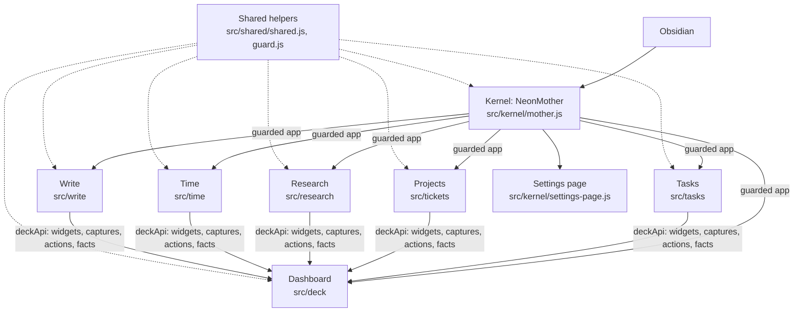

# Neon Deck (fork) — architecture

One Obsidian plugin (`neon-deck-fork`) made of a kernel and six modules. This page is the current design; `MAP.md` lists every file and function, `FORK.md` what differs from upstream Neon Deck 2.2.0.

## Shape

- **Kernel** (`src/kernel/mother.js`): the plugin Obsidian loads. It runs each module as a **child `Plugin`** with its own id, data folder and settings, so Obsidian's Plugin lifecycle removes everything a module registered when it is switched off. It also:
  - gives every module a **guarded `app`** (see *Read-only guard*);
  - keeps the kernel state in `modules.json`: module switches, safe mode, read-only, the base folder and the open settings section;
  - names each module `<plugin name> – <section>` (command palette, notices) and sets `NEON_APP.name`, so the UI always uses the plugin's manifest name;
  - refuses to start when the original Neon Deck is also enabled (same views and commands).
- **Settings page** (`src/kernel/settings-page.js`): the plugin's only page in Settings. Sections: Overview (read-only, base folder, module switches, safe mode) and one per module. Modules still build their own `PluginSettingTab`; the kernel captures it (it overrides `child.addSettingTab`) and draws it inside the section, so modules add no sidebar pages. `BaseFolderModal` asks for the base folder on first start.
- **Modules** (`src/<module>/`). Each has `plugin.js` (the Plugin class: load, settings, events) and job files that add methods with `Object.assign(Class.prototype, { ... })`. Module ids and folders keep upstream's names, so saved data and layouts carry on:

| Section | Module id | Folder | Class | Main view type |
|---|---|---|---|---|
| Dashboard | `neon-deck` | `src/deck` | `NeonDeck` | `neon-deck-dashboard`, `neon-deck-cards`, `neon-deck-graph` |
| Tasks | `neon-tasks` | `src/tasks` | `NeonTasks` | `neon-tasks-view` |
| Projects | `neon-tickets` | `src/tickets` | `NeonProjects` | `neon-deck-tickets` |
| Research | `neon-research` | `src/research` | `NeonResearch` | `neon-research` |
| Time | `neon-time` | `src/time` | `NeonTime` | `neon-time` |
| Write | `neon-write` | `src/write` | `NeonWrite` | — |

- **Shared** (`src/shared/shared.js`, `guard.js`, `note-index.js`): helpers every module uses (format, DOM, categories, daily notes, files, `writeNote`, path suggestions, the base folder), the read-only guard and the note index. One copy, loaded before the modules.
- **Note index** (`src/shared/note-index.js`): one list of the vault's notes with their metadata, tags and whether they hold open tasks. The kernel keeps it current from Obsidian's events (`changed`, `delete`, `rename`, the first `resolved`); modules ask `noteIndex(app)` for `projects()`, `withOpenTasks()` and `withProperty(key)` instead of each walking every note. Each module still caches its own results (for example the project list until a project note changes).

## Shared configuration

Settings that several modules need live in small shared objects, filled by whichever part owns the setting:

| Object | Set by | Holds |
|---|---|---|
| `NEON_APP` | kernel | the plugin's display name (`appName()`) |
| `NEON_GUARD` | kernel | read-only on/off, the plugin's own folder, notice timing |
| `NEON_BASE` | kernel | the base folder; `basePath(name)` and `locPath(setting, name)` turn an empty location into `<base>/<name>` |
| `NEON_PROJECTS` | Projects | the project tag, status value → group map, status order, cancelled value |
| `NEON_CATS` + `CATS`, `CAT_LABEL` | Projects / Dashboard (`refreshCategories`) | customers as categories, from the folders in the customers folder; the upstream four categories when there is none |
| `NEON_DAILY_FALLBACK` | Dashboard | daily-note folder, format and template used while the core Daily notes plugin is off |
| `neonIndex` | kernel | the shared note index (`noteIndex(app)`) |

## How the parts meet

- **Modules never import each other.** They meet through the Deck API (`deckApi(app)`: widgets, capture targets, sidebar actions, facts, week lines, recently done, exclusions, services) and workspace events (`neon:task-done`, `neon:project-changed`, `neon:time-entry`). A module that is off is simply absent; every caller handles `null`.
- **The sidebar list** (Dashboard, Cards, then each module's action by `order`, then Graph) opens views in one main pane; `MAIN_VIEWS` lists the views that share it.
- **The dashboard grid** is a fixed layout of named slots (`DASH_LAYOUT`); a module fills a slot with `registerWidget`, and an empty slot falls back to a neighbour (`SLOT_FALLBACK`). The Claude card and Quick capture share one slot.
- **Exclusions:** stats, the graph, tasks and projects skip the excluded folders: the setting, the templates folders (core Templates and Templater), top-level archive folders, and any a module registers.

## Notes the plugin reads

| What | How it is recognised |
|---|---|
| Project | `project` (setting) in the `tags` property; status from `status`, customer from `customer` or the customer folder; `started`, `due`, `completed`, `cancelled`, `remind`, `stage`, `note` |
| Task | a checkbox line (`[ ]`, `[/]`) with `#task` (setting) anywhere; every checkbox in notes tagged `tasks`, in recent daily notes and in the Todo note; dates as in the Tasks plugin (📅 ⏳ 🛫 ➕ ✅) |
| Daily or weekly note | the core Daily notes plugin's folder and format (formats with folders, e.g. `YYYY/YYYY-ww`, match the path) |
| Research note | any note in a research section (folder or `*` pattern); status from `status` (setting) |
| Category | the `customer` property, else the folder under the customers folder |
| Claude card | the `claude` property (`process`, `refine` → waiting; `updated` → to review) |

## Writing

- **Read-only guard** (`src/shared/guard.js`): while read-only is on (the default), the guarded `app` given to every module refuses `vault` (create, modify, process, append, delete, trash, rename, copy), `fileManager` (renameFile, processFrontMatter, trashFile) and `vault.adapter` writes, apart from the plugin's own folder under `.obsidian/plugins/`. `writeNote` checks it too. A refused write after a click or key press shows a notice; background jobs are refused quietly. Obsidian's real `app` is never changed.
- **When writes are allowed**, the plugin writes only for an action you take (tick or add a task, change a project's status, create a note, pin something) or for its own notes (time log, weekly review, pin board). It never moves or renames notes on its own.
- **One write path:** text changes go through `writeNote(app, file, fn)`: one write at a time per note; when the note is open in an editor, the change is applied there as a minimal edit, so the cursor and undo stay. Property changes go through `processFrontMatter`.
- **Templates** are filled by `applyTemplate`: `{{title}}`, `{{date}}`, `{{date:FORMAT}}`, `{{time}}`, `<% tp.file.title %>` and `<% tp.date.now("FORMAT") %>`.

## Rules the code relies on

- **100% local:** no network, no system notifications, no `child_process`, no `eval`, no `innerHTML` with data. Fonts are embedded in `styles.css`.
- **Isolation:** a module that throws while starting is stopped alone; if the plugin crashed while starting, the next start is safe mode (all modules off).
- **Keep formats:** settings keys, note formats, command ids and view types don't change without a migration. Settings from earlier builds are migrated on load (for example `dropOldDefaults` clears unused `Neon/…` paths).
- **UI text** names the plugin with `appName()` and the parts by their section names (Dashboard, Tasks, Projects, Research, Time, Write).

## Build and checks

- `node tools/build.mjs` joins `src/` (order in `tools/files.json`) into `dist/<manifest id>/{main.js,styles.css,manifest.json}`; each module is wrapped in its own scope, and the kernel comes last.
- `node --test test/*.test.mjs`: unit tests on the real source files with a small Obsidian stand-in (`test/load.mjs`).
- `node tools/check.mjs dist`: local-only rules, cleanup, timers, writes, CSS, file sizes.
- `node tools/map.mjs` regenerates `MAP.md`.

## Open

- **Note index for the rest of the dashboard:** stats, the graph and the card explorer still list notes themselves (cheap, but they could use the index too).
- **Screenshots** in `docs/screenshots/` are from upstream and out of date.
